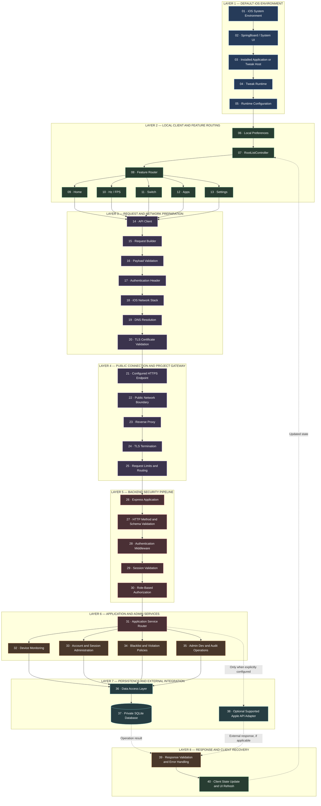

# System server 

The `BoostiPhone6s` architecture describes the complete request lifecycle from the default iOS environment through the tweak runtime, network transport, project gateway, authentication, application services, administrative controls, persistent storage, and the response path back to the client.

The architecture is organized into **40 logical connection points** across eight layers. These points describe the intended system boundaries and request-processing stages; they do not imply that every point is implemented as a separate service, API endpoint, or network connection.

### 1. Complete System Architecture — 40 Connection Points

### 2. Layer 1 — Default iOS Environment

This layer represents the operating-system environment in which the tweak and its configuration interface operate.

| Point | Component                           | Responsibility                                                       |
| ----- | ----------------------------------- | -------------------------------------------------------------------- |
| 01    | iOS System Environment              | Provides the operating-system environment and available system APIs. |
| 02    | SpringBoard / System UI             | Represents system UI integration where applicable.                   |
| 03    | Installed Application or Tweak Host | Provides the host process or application context.                    |
| 04    | Tweak Runtime                       | Executes the tweak code in its supported runtime context.            |
| 05    | Runtime Configuration               | Supplies feature settings and configuration values.                  |

These are logical boundaries. The actual process, injection mechanism, and system API calls depend on the tweak implementation and iOS version.

### 3. Layer 2 — Local Client and Feature Routing

The local configuration interface presents the available features and determines which client-side actions are requested.

| Point | Component          | Responsibility                                               |
| ----- | ------------------ | ------------------------------------------------------------ |
| 06    | Local Preferences  | Stores supported local configuration values.                 |
| 07    | RootListController | Presents the tweak's settings interface.                     |
| 08    | Feature Router     | Dispatches user actions to the relevant feature handler.     |
| 09    | Home               | Displays the main feature interface.                         |
| 10    | Hz / FPS           | Handles the configured refresh-rate and frame-rate controls. |
| 11    | Switch             | Handles supported feature toggles.                           |
| 12    | Apps               | Presents supported application-related settings.             |
| 13    | Settings           | Provides configuration and service options.                  |

The feature router is a conceptual responsibility, not necessarily a separate class or source file.

Local display settings and controls do not inherently require server requests. A feature should call the backend only when its implementation requires remote authentication, authorization, synchronization, or another defined server operation.

### 4. Layer 3 — Request and Network Preparation

When a feature requires a remote operation, the client prepares and sends a request through the supported iOS networking APIs.

| Point | Component                  | Responsibility                                                           |
| ----- | -------------------------- | ------------------------------------------------------------------------ |
| 14    | API Client                 | Manages configured client-to-server requests.                            |
| 15    | Request Builder            | Constructs the HTTP method, URL, headers, and payload.                   |
| 16    | Payload Validation         | Checks required fields and basic client-side constraints.                |
| 17    | Authentication Header      | Attaches a session credential when required.                             |
| 18    | iOS Network Stack          | Transmits requests through the operating system's networking facilities. |
| 19    | DNS Resolution             | Resolves the configured hostname to an address.                          |
| 20    | TLS Certificate Validation | Validates the server certificate and establishes a secure connection.    |

Client-side validation improves reliability but is not a replacement for backend validation. The server must treat client-supplied values as untrusted.

The configured hostname should belong to the project owner or to a service the project is authorized to use.

### 5. Layer 4 — Public Connection and Project Gateway

This layer receives requests addressed to the project's configured public endpoint.

| Point | Component                  | Responsibility                                                                        |
| ----- | -------------------------- | ------------------------------------------------------------------------------------- |
| 21    | Configured HTTPS Endpoint  | Defines the actual public service address used by the client.                         |
| 22    | Public Network Boundary    | Separates the public network from protected infrastructure.                           |
| 23    | Reverse Proxy              | Routes permitted requests to the backend.                                             |
| 24    | TLS Termination            | Handles the HTTPS connection when TLS terminates at the proxy.                        |
| 25    | Request Limits and Routing | Applies configured limits and forwards requests to the appropriate application route. |

The public endpoint may use a project-specific display name in the UI and documentation. Its actual DNS hostname and certificate must still correspond to the real service.

A reverse proxy can conceal private backend addresses from ordinary clients, but it does not make a project server an Apple-operated server.

### 6. Layer 5 — Backend Security Pipeline

Every protected request should pass through the applicable validation, authentication, and authorization checks before executing a privileged operation.

| Point | Component                         | Responsibility                                                  |
| ----- | --------------------------------- | --------------------------------------------------------------- |
| 26    | Express Application               | Receives and dispatches HTTP requests.                          |
| 27    | HTTP Method and Schema Validation | Validates allowed methods, content types, and request fields.   |
| 28    | Authentication Middleware         | Verifies the credentials or session required by the route.      |
| 29    | Session Validation                | Checks session validity, expiration, and revocation status.     |
| 30    | Role-Based Authorization          | Checks whether the account may perform the requested operation. |

#### Security Processing Order

1. Reject malformed or unsupported requests.
2. Validate the required authentication credentials.
3. Check account and session status.
4. Check the permissions required by the endpoint.
5. Validate operation-specific business rules.
6. Execute the authorized operation.
7. Return a controlled response and record relevant security events.

Public health endpoints and login endpoints may use different middleware policies because they must be accessible before an authenticated session exists. They should expose only the minimum information necessary.

### 7. Layer 6 — Application and Administration Services

After authorization succeeds, the application routes the request to the appropriate service.

| Point | Component                          | Responsibility                                                 |
| ----- | ---------------------------------- | -------------------------------------------------------------- |
| 31    | Application Service Router         | Dispatches requests to the corresponding service handler.      |
| 32    | Device Monitoring                  | Processes supported monitoring check-ins.                      |
| 33    | Account and Session Administration | Handles authorized account and session operations.             |
| 34    | Blacklist and Violation Policies   | Applies configured restriction and violation rules.            |
| 35    | Admin Dev and Audit Operations     | Provides designated administrative functions and audit access. |

The actual feature set must match the backend code. A diagram does not create a route or enable a function that has not been implemented.

#### Admin Dev Access

Admin Dev should be treated as a privileged backend role, not simply a UI mode.

Administrative operations should require:

* A valid authenticated session.
* A server-side role or permission check.
* Validated target identifiers and request fields.
* Business-rule validation before destructive changes.
* Audit logging for relevant administrative actions.

Hiding the Admin Dev interface in the tweak is useful for presentation but is not an authorization control.

### 8. Layer 7 — Persistence and External Integration

| Point | Component                            | Responsibility                                                                                   |
| ----- | ------------------------------------ | ------------------------------------------------------------------------------------------------ |
| 36    | Data Access Layer                    | Encapsulates database queries and persistence operations.                                        |
| 37    | Private SQLite Database              | Stores supported persistent application records.                                                 |
| 38    | Optional Supported Apple API Adapter | Integrates an external Apple service only when a supported API and required authorization exist. |

#### Database Security

The database should remain inside a protected application data directory. Access should be limited to the backend process and authorized maintenance operations.

Recommended controls include:

* Parameterized SQL queries.
* Transactions for related updates.
* Appropriate indexes.
* Protected backups.
* Restricted filesystem permissions.
* Schema migrations and tested recovery procedures.
* No direct public access to the database file.

#### Apple API Integration

Point 38 is optional and must remain inactive unless the project has a valid integration configuration.

It must not be interpreted as a direct connection to Apple's internal servers, private infrastructure, or undocumented services. Any external integration must use an interface supported by the relevant service.

### 9. Layer 8 — Response and Client Recovery

| Point | Component                              | Responsibility                                                            |
| ----- | -------------------------------------- | ------------------------------------------------------------------------- |
| 39    | Response Validation and Error Handling | Converts service outcomes into controlled responses and handles failures. |
| 40    | Client State Update and UI Refresh     | Updates the client interface based on the returned result.                |

The response path should distinguish between:

* Successful operations.
* Authentication failures.
* Authorization failures.
* Invalid requests.
* Missing resources.
* Rate limits.
* Temporary upstream failures.
* Internal service errors.

The client should not interpret an unavailable server as proof that an operation succeeded. It should preserve safe local state, display an appropriate error, and retry only when the operation and failure type make retrying appropriate.

---

### 10. Security Controls Across All 40 Points

The following controls apply across the architecture rather than to only one node.

| Control            | Required behavior                                               |
| ------------------ | --------------------------------------------------------------- |
| Transport Security | Use HTTPS for public production requests.                       |
| Authentication     | Validate credentials and sessions on the backend.               |
| Authorization      | Enforce permissions for every protected endpoint.               |
| Input Validation   | Validate all externally supplied fields.                        |
| Session Lifecycle  | Define expiration, logout, and revocation behavior.             |
| Rate Limiting      | Restrict abusive or excessive requests.                         |
| Database Isolation | Keep persistent storage inaccessible from the public network.   |
| Secret Management  | Keep passwords, tokens, and private keys out of source control. |
| Audit Logging      | Record relevant administrative and security events.             |
| Error Handling     | Avoid exposing internal secrets or stack traces.                |
| Privacy            | Collect only the data required by the service.                  |
| Recovery           | Maintain protected backups and test restoration.                |

### 11. Connection Boundaries and Trust Model

The architecture contains several distinct trust boundaries:

1. **iOS boundary:** client-side state and identifiers may be modified by the client environment.
2. **Network boundary:** requests and responses cross an untrusted network.
3. **Gateway boundary:** the reverse proxy accepts public connections and forwards permitted requests.
4. **Authentication boundary:** credentials and session state are verified.
5. **Authorization boundary:** the backend determines whether an action is permitted.
6. **Persistence boundary:** database operations are restricted to authorized application code.
7. **External-service boundary:** any Apple API integration has its own authentication and authorization requirements.

No trust boundary should be bypassed merely because the client uses a familiar display name or because an earlier stage of the request succeeded.

### 12. Important Implementation Notes

* The 40 numbered points represent logical stages, not 40 separate servers.
* Several stages may be implemented in one source file or process.
* Home, Hz/FPS, Switch, Apps, and Settings are UI features; they are not automatically network endpoints.
* Apple Services and the project backend are separate systems.
* A connection to an Apple service must be explicitly supported and configured.
* The project gateway must use its actual configured endpoint.
* Admin Dev permissions must be enforced on the server.
* Database schemas and route names must be verified against the deployed backend.
* The actual request flow depends on the client source code and server configuration.

**Architecture summary:** iOS environment → tweak runtime → local feature routing → request preparation → HTTPS gateway → backend validation → authentication → authorization → application services → private database or optional supported external integration → response handling → client state update.

This section describes the intended architecture of `BoostiPhone6s`. It does not assert that all 40 points or every recommended security control are currently implemented.
