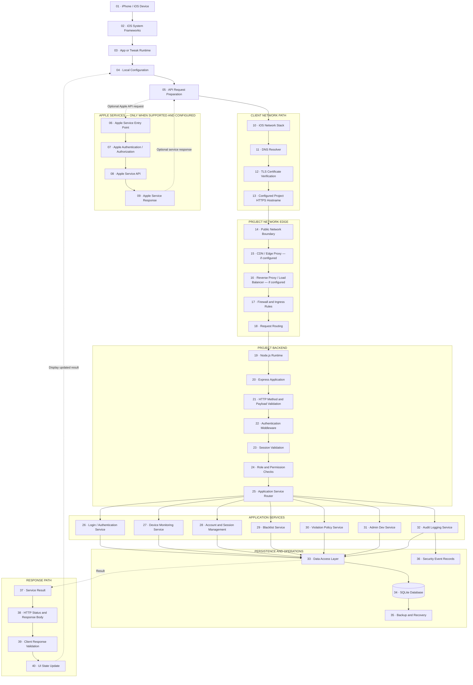

## System Architecture — Apple-to-Backend Integration Flow

> **Architecture model — not an official Apple infrastructure diagram.** This diagram illustrates the conceptual path from the iOS device and optional Apple service integration to the project's own backend. Actual Apple services, intermediate providers, and network hops depend on the supported APIs and deployment configuration.

### 1. Full Connection Flow

### 2. What Each Server Layer Does

| Stage | Layer                   | Purpose                                                                             |
| ----: | ----------------------- | ----------------------------------------------------------------------------------- |
| 01–05 | iOS client              | Runs the supported client code and prepares requests.                               |
| 06–09 | Optional Apple services | Handles only the Apple APIs explicitly supported and configured by the project.     |
| 10–13 | Client networking       | Resolves the configured hostname and establishes a validated HTTPS connection.      |
| 14–18 | Network edge            | Optionally filters, proxies, and routes incoming traffic.                           |
| 19–25 | Backend security        | Receives requests, validates input, authenticates sessions, and checks permissions. |
| 26–32 | Application services    | Handles login, monitoring, sessions, restrictions, Admin Dev, and auditing.         |
| 33–36 | Persistence             | Stores records and supports backup and security operations.                         |
| 37–40 | Response path           | Returns the operation result to the client and updates the interface.               |

### 3. Important Connection Rules

* Apple services and the project backend are separate trust domains.
* The project backend receives requests only when the client or an authorized integration actually sends them to the configured project endpoint.
* A CDN, load balancer, or reverse proxy is present only if deployed.
* Authentication and role checks must be enforced by the backend, not just by the interface.
* The database should not be directly exposed to the public network.
* Apple authentication does not automatically authenticate a user to the project's own backend.
* A successful TLS connection does not mean the requested operation is authorized.
* Error responses must not be treated as successful operations.

### 4. Actual Deployment Versus Conceptual Architecture

The diagram is a **proposed integration model**. Before describing any component as active, verify the actual hostname, supported Apple API, proxy configuration, backend route, authentication policy, and database implementation.

Do not label a privately operated server as an official Apple server. A project-controlled gateway can use a neutral name such as `Service Gateway` or `Apple API Integration Gateway` when it genuinely connects to a supported Apple API, provided the documentation clearly identifies the project as independent.
