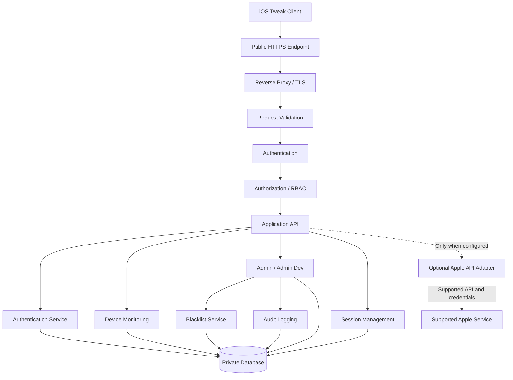
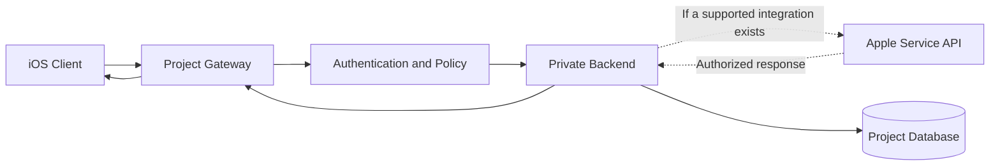
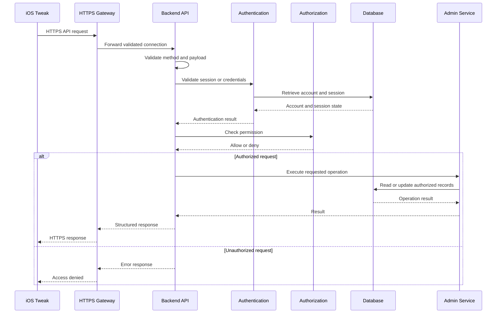
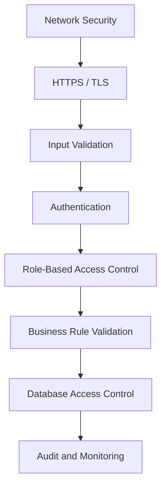
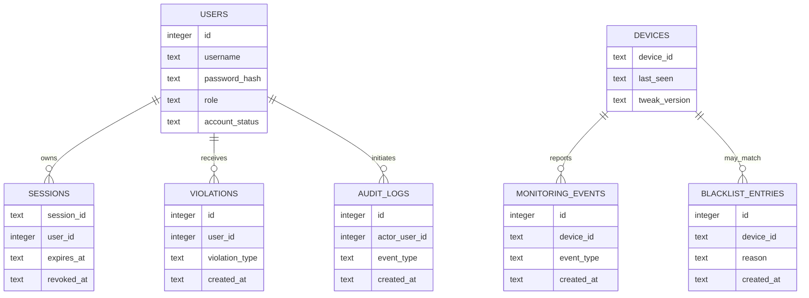

#  Apple-Compatible Service Gateway

<p align="center">
  <strong>Secure iOS Tweak Backend Infrastructure</strong>
  <br>
  Authentication · Authorization · API Gateway · Device Monitoring · Administration
</p>

<p align="center">
  
  
  
  
</p>

<p align="center">
  Independent backend architecture for authorized iOS tweak services.
</p>

---

## Table of Contents

1. [Overview](#1-overview)
2. [System Architecture](#2-system-architecture)
3. [Apple Services Integration](#3-apple-services-integration)
4. [Complete Connection Flow](#4-complete-connection-flow)
5. [Security Architecture](#5-security-architecture)
6. [Project Structure](#6-project-structure)
7. [Core Components](#7-core-components)
8. [Authentication](#8-authentication)
9. [Authorization and Roles](#9-authorization-and-roles)
10. [Session Management](#10-session-management)
11. [Device Monitoring](#11-device-monitoring)
12. [Administration](#12-administration)
13. [Violation Management](#13-violation-management)
14. [Audit Logging](#14-audit-logging)
15. [API Reference](#15-api-reference)
16. [Database Architecture](#16-database-architecture)
17. [Environment Configuration](#17-environment-configuration)
18. [Installation](#18-installation)
19. [Production Deployment](#19-production-deployment)
20. [iOS Tweak Integration](#20-ios-tweak-integration)
21. [Security Hardening](#21-security-hardening)
22. [Monitoring and Maintenance](#22-monitoring-and-maintenance)
23. [Troubleshooting](#23-troubleshooting)
24. [Privacy](#24-privacy)
25. [Disclaimer](#25-disclaimer)

---

## 1. Overview

Apple-Compatible Service Gateway is an independent backend architecture for iOS tweak authentication, API routing, access control, session management, device monitoring, and administrative operations.

The architecture separates the iOS client, public connection endpoint, application backend, authorization layer, and persistent database.

The service name is a configurable project label. It does not indicate that this backend is owned, hosted, operated, or endorsed by Apple Inc.

### Main Capabilities

| Component                | Description                                             |
| ------------------------ | ------------------------------------------------------- |
| Connection Gateway       | Public HTTPS entry point for configured client requests |
| Authentication           | Validates account credentials                           |
| Authorization            | Enforces server-side role permissions                   |
| Session Management       | Validates, expires, and revokes sessions                |
| Device Monitoring        | Receives supported device and version check-ins         |
| Blacklist                | Maintains persistent device restrictions                |
| Violation Management     | Applies configured account restriction policies         |
| Audit Logging            | Records security-relevant administrative events         |
| Database                 | Stores persistent application records                   |
| Health Monitoring        | Reports basic application availability                  |
| Transport Security       | Uses HTTPS for public production connections            |
| Configuration Management | Keeps deployment settings outside source code           |

### Architecture Principles

* All public production API traffic uses HTTPS.
* Privileged actions require server-side authorization.
* Client-side UI restrictions are not treated as security controls.
* Database queries use parameterized statements.
* Credentials and tokens are never intentionally written to application logs.
* Persistent restrictions survive application restarts.
* Third-party service integrations are configured explicitly.
* Only necessary device and account data is collected.

> **Implementation note:** This README documents the intended architecture and API contract. Features, directories, database tables, and security controls must be verified against the actual backend code before being considered implemented.

---

## 2. System Architecture

The following diagram describes the complete intended architecture, including an optional external Apple Services integration.



### Component Responsibilities

**iOS Tweak Client**

Sends API requests for the functions that are configured to use the backend. It should not contain database credentials or privileged server secrets.

**Public HTTPS Endpoint**

The public hostname clients connect to. It can be a domain controlled by the project owner.

**Reverse Proxy / TLS**

Terminates HTTPS, forwards permitted requests to the backend, and applies connection, timeout, and request-size limits.

**Authentication**

Validates account credentials or an existing session.

**Authorization / RBAC**

Checks whether the authenticated account has permission to execute the requested operation.

**Application API**

Dispatches validated requests to the relevant service.

**Private Database**

Stores application state and remains inaccessible directly from the public internet.

**Optional Apple API Adapter**

A separate integration component for an Apple service that explicitly supports the required API and authentication method. It is not an automatic connection to Apple's internal infrastructure.

---

## 3. Apple Services Integration

### Connection Model

The architecture distinguishes between three separate concepts:

1. **Apple Services:** external Apple-operated services, accessed only through supported interfaces and permitted credentials.
2. **Project Gateway:** the public endpoint configured for this project.
3. **Private Backend:** the application service and database controlled by the project owner.

A possible integration flow is:



### Important Integration Requirements

An Apple service can be integrated only when the relevant service provides a supported interface and the project has the necessary authorization.

Depending on the service, requirements may include:

* An official API endpoint.
* Valid developer or account credentials.
* Required authorization scopes.
* Compliance with service terms and rate limits.
* Secure storage of server-side secrets.
* Validation of external API responses.
* Appropriate error handling and retry limits.

Do not assume that Apple services expose private APIs for tweak settings, device administration, Hz/FPS controls, or arbitrary backend forwarding.

### Server Naming

The project may use `Apple-Compatible Service Gateway` as a descriptive project name. This does not establish an official Apple connection.

The real public hostname, backend address, and any supported Apple API endpoint must be configured separately.

---

## 4. Complete Connection Flow

The following diagram describes the request lifecycle from the iOS client to the backend and back.



### Request Processing Stages

1. The client connects to the configured public HTTPS endpoint.
2. The reverse proxy applies network-level protections.
3. The backend validates the request structure.
4. Authentication verifies the credentials or session.
5. Authorization evaluates the permissions required by the endpoint.
6. The service executes the permitted operation.
7. The database persists changes where necessary.
8. The backend returns a response without exposing internal secrets.

Requests that fail authentication or authorization must not execute privileged operations.

---

## 5. Security Architecture

### Defense in Depth



### Security Layers

| Layer          | Protection                                           |
| -------------- | ---------------------------------------------------- |
| Network        | Firewall, private backend port, connection limits    |
| Transport      | HTTPS and valid TLS certificates                     |
| Request        | Method, content-type, size, and schema validation    |
| Authentication | Password verification and session validation         |
| Authorization  | Server-side role and permission checks               |
| Business Logic | Account status and policy checks                     |
| Persistence    | Parameterized queries and restricted database access |
| Operations     | Secret management, backups, audit, and monitoring    |

### Threats and Mitigations

| Threat                      | Recommended mitigation                                 |
| --------------------------- | ------------------------------------------------------ |
| Credential guessing         | Rate limits, generic errors, monitoring                |
| Token theft                 | HTTPS, limited token exposure, revocation, expiry      |
| Unauthorized administration | Server-side authorization on every protected route     |
| SQL injection               | Parameterized queries                                  |
| Data exposure               | Restricted database access and minimal API responses   |
| Secret leakage              | Environment-based configuration and secret rotation    |
| Replay or stale sessions    | Expiration, revocation, and fresh authorization checks |
| Abuse of public endpoints   | Rate limiting and request-size limits                  |
| Database loss               | Protected backups and tested restoration               |
| Excessive logging           | Redaction and log retention limits                     |

These are security requirements and recommendations. Their presence in this document does not prove they are implemented in the current server.

---

## 6. Project Structure

The following structure is a recommended organization for a modular Node.js/Express backend.

```text
apple-compatible-service-gateway/
│
├── server.js
├── package.json
├── package-lock.json
├── .env.example
├── .gitignore
├── README.md
│
├── src/
│   ├── app.js
│   │
│   ├── config/
│   │   ├── environment.js
│   │   └── database.js
│   │
│   ├── routes/
│   │   ├── health.routes.js
│   │   ├── auth.routes.js
│   │   ├── monitoring.routes.js
│   │   └── admin.routes.js
│   │
│   ├── middleware/
│   │   ├── authenticate.js
│   │   ├── authorize.js
│   │   ├── validateRequest.js
│   │   ├── rateLimit.js
│   │   └── errorHandler.js
│   │
│   ├── services/
│   │   ├── auth.service.js
│   │   ├── session.service.js
│   │   ├── monitoring.service.js
│   │   ├── admin.service.js
│   │   ├── violation.service.js
│   │   └── appleApi.service.js
│   │
│   ├── repositories/
│   │   ├── user.repository.js
│   │   ├── session.repository.js
│   │   ├── device.repository.js
│   │   └── audit.repository.js
│   │
│   └── utils/
│       ├── logger.js
│       └── response.js
│
├── data/
│   └── .gitkeep
│
├── logs/
│   └── .gitkeep
│
└── tests/
    ├── auth.test.js
    ├── session.test.js
    ├── admin.test.js
    └── monitoring.test.js
```

### Directory Responsibilities

| Directory / File    | Responsibility                                                |
| ------------------- | ------------------------------------------------------------- |
| `server.js`         | Starts the application                                        |
| `src/app.js`        | Configures Express middleware and routes                      |
| `src/config/`       | Validates configuration and initializes persistence           |
| `src/routes/`       | Defines HTTP methods and endpoint paths                       |
| `src/middleware/`   | Authentication, authorization, validation, and error handling |
| `src/services/`     | Implements business rules                                     |
| `src/repositories/` | Encapsulates database operations                              |
| `src/utils/`        | Shared helpers and safe logging                               |
| `data/`             | Private persistent application data                           |
| `logs/`             | Application logs, if file logging is enabled                  |
| `tests/`            | Automated test suites                                         |

The current project may use a single-file backend instead. Do not assume these files exist until the repository has been inspected.

---

## 7. Core Components

### 7.1 API Gateway

The gateway is the public entry point for client requests.

Responsibilities:

* Receive HTTPS requests.
* Route requests to the appropriate backend service.
* Enforce request-size limits.
* Apply network and request-level controls.
* Forward only approved traffic to the application.
* Return consistent error responses.

The gateway should not expose internal service ports or database files.

### 7.2 Authentication Service

Responsibilities:

* Validate credential input.
* Retrieve the account record.
* Verify the password hash.
* Check whether the account is enabled.
* Create a session after successful authentication.
* Reject invalid or revoked sessions.

### 7.3 Authorization Service

Responsibilities:

* Check account role and permissions.
* Protect administrative routes.
* Enforce restrictions at the backend.
* Deny requests with missing or insufficient permissions.

### 7.4 Monitoring Service

Responsibilities:

* Receive authorized check-ins.
* Validate device identifiers and tweak versions.
* Update supported monitoring records.
* Apply appropriate retention policies.

### 7.5 Administration Service

Responsibilities may include:

* Device listing.
* Blacklist management.
* Session revocation.
* Violation-policy administration.
* Audit-event retrieval.

Each action must be restricted to the appropriate role.

### 7.6 Apple API Adapter

This optional component isolates external service integration from the main application.

Responsibilities, if an approved Apple API is configured:

* Use the documented external API.
* Authenticate according to that service's requirements.
* Keep credentials on the server.
* Validate upstream responses.
* Handle timeouts and rate limits.
* Avoid forwarding private credentials to the iOS client.

If no supported Apple integration is configured, this component should remain disabled or absent.

---

## 8. Authentication

### Login

`POST /v1/auth/login`

Example request:

```json
{
  "username": "example_user",
  "password": "replace_with_your_password",
  "device_id": "example-device-id"
}
```

The `device_id` field is optional under the documented API contract.

Expected processing:

1. Validate request fields.
2. Apply login rate limits.
3. Retrieve the account.
4. Compare the submitted password with its stored hash.
5. Check account status.
6. Create a session if authentication succeeds.
7. Return the minimum information needed by the client.

The actual response format must match the implementation.

### Current Session

`GET /v1/auth/me`

Required header:

```http
Authorization: Bearer YOUR_SESSION_TOKEN
```

The endpoint validates the active session and returns appropriate account information.

### Logout

`POST /v1/auth/logout`

The server should invalidate the current session where server-side revocation is supported.

Removing a token from the client alone does not invalidate a copied token.

### Password Security

* Never store passwords in plaintext.
* Use bcrypt or another suitable password-hashing algorithm.
* Use a suitable hashing work factor.
* Never return password hashes to clients.
* Do not log passwords or authentication tokens.
* Rotate credentials if they are exposed.

---

## 9. Authorization and Roles

The documented account roles are `admin` and `admin_dev`.

| Role        | Intended scope                                                           |
| ----------- | ------------------------------------------------------------------------ |
| `admin`     | Standard administrative functions configured for this role               |
| `admin_dev` | Designated development administration and security-management operations |

Exact permissions depend on the backend implementation.

### Authorization Rules

* Every protected endpoint must validate the session.
* Every privileged operation must check the required role.
* Account restrictions must be evaluated server-side.
* Missing, expired, or revoked sessions must be rejected.
* UI visibility must never determine backend permissions.
* Administrative actions should be audited.

### Example Environment Variables

```dotenv
ADMIN_USER=change_this_admin_username
ADMIN_PASSWORD=replace_with_a_strong_password

DEV_ADMIN_USER=change_this_dev_username
DEV_ADMIN_PASSWORD=replace_with_another_strong_password
```

These variables are examples. Use them only if the application actually reads them.

---

## 10. Session Management

Session management tracks whether an authenticated client remains authorized.

### Expected Capabilities

* Create a session after successful authentication.
* Validate bearer tokens.
* Enforce session expiration.
* Revoke sessions on logout where implemented.
* Support administrative revocation.
* Reject revoked sessions.
* Recheck authorization for sensitive operations.

### Revoke Session

`POST /v1/admin/revoke-session`

Required role: `admin_dev`.

Example request:

```json
{
  "session_id": "example-session-id"
}
```

The server should validate the caller's role, revoke the specified session, and record the operation when audit logging is supported.

### Offline Behavior

A disconnected client cannot receive immediate revocation notifications. The backend must check session validity when the client reconnects and before sensitive operations.

---

## 11. Device Monitoring

### Check-in

`POST /v1/monitor/checkin`

Required authentication: bearer token.

Example request:

```json
{
  "device_id": "example-device-id",
  "tweak_version": "1.0.0"
}
```

### Data Fields

Depending on the implementation, monitoring records may contain:

* Pseudonymous device identifier.
* Reported tweak version.
* Last-seen timestamp.
* Operational status.

### Security Requirements

* Validate the request.
* Require appropriate authentication.
* Restrict access to administrative monitoring data.
* Apply data-retention rules.
* Do not collect unrelated personal data.
* Treat client-reported device identifiers and versions as untrusted input.

A reported version is not proof that a binary is genuine or untampered.

---

## 12. Administration

### List Devices

`GET /v1/admin/devices`

Intended role: `admin_dev`.

Returns device information that the authenticated role is permitted to view.

### Add Blacklist Entry

`POST /v1/admin/blacklist`

Intended role: `admin_dev`.

Example request:

```json
{
  "device_id": "example-device-id",
  "reason": "Administrative review"
}
```

### Remove Blacklist Entry

`DELETE /v1/admin/blacklist/:deviceId`

Intended role: `admin_dev`.

### Administrative Security Requirements

* Validate all input fields.
* Check the caller's permissions on the server.
* Use parameterized queries.
* Record the actor and operation where supported.
* Return minimal error details.
* Protect sensitive monitoring and audit information.

---

## 13. Violation Management

`POST /v1/admin/violation`

Intended role: `admin_dev`.

Example request:

```json
{
  "username": "example_user",
  "device_id": "example-device-id"
}
```

### Documented Escalation Policy

| Violation        | Intended restriction          |
| ---------------- | ----------------------------- |
| First violation  | 3-hour restriction            |
| Second violation | 3-day restriction             |
| Third violation  | Permanent account disablement |

These durations describe the intended policy. Verify the actual backend before relying on them.

### Policy Requirements

* Record violations durably.
* Use server-side timestamps.
* Define counting and reset behavior.
* Apply account restrictions server-side.
* Record significant policy changes.
* Provide an administrative review process.
* Do not allow an untrusted client to impose administrative restrictions.

---

## 14. Audit Logging

`GET /v1/admin/audit`

Intended role: `admin_dev`.

Audit records may cover:

* Administrative operations.
* Blacklist changes.
* Session revocation.
* Violation-policy actions.
* Relevant account-management events.
* Failed privileged requests, where configured.

### Recommended Audit Fields

| Field      | Purpose                                  |
| ---------- | ---------------------------------------- |
| Event ID   | Unique event identifier                  |
| Timestamp  | Time of the event                        |
| Actor      | Account performing the operation         |
| Event Type | Type of operation                        |
| Target     | Resource affected, if applicable         |
| Outcome    | Success or failure                       |
| Metadata   | Minimal non-sensitive diagnostic context |

Never log plaintext passwords, bearer tokens, private keys, or complete authentication secrets.

Audit records should be access-controlled and retained according to an explicit policy.

---

## 15. API Reference

The following table documents the intended API contract.

| Method   | Endpoint                        | Purpose                              |
| -------- | ------------------------------- | ------------------------------------ |
| `GET`    | `/health`                       | Basic health check                   |
| `POST`   | `/v1/auth/login`                | Authenticate an account              |
| `GET`    | `/v1/auth/me`                   | Validate the current session         |
| `POST`   | `/v1/auth/logout`               | End the current session              |
| `POST`   | `/v1/monitor/checkin`           | Submit a monitoring check-in         |
| `GET`    | `/v1/admin/devices`             | Retrieve device information          |
| `POST`   | `/v1/admin/blacklist`           | Add a blacklist entry                |
| `DELETE` | `/v1/admin/blacklist/:deviceId` | Remove a blacklist entry             |
| `POST`   | `/v1/admin/revoke-session`      | Revoke a session                     |
| `POST`   | `/v1/admin/violation`           | Register an administrative violation |
| `GET`    | `/v1/admin/audit`               | Retrieve audit events                |

### Access Matrix

| Endpoint group | Authentication            | Permission                                 |
| -------------- | ------------------------- | ------------------------------------------ |
| Health         | Usually not required      | Public health status only                  |
| Login          | Not required before login | Credential verification                    |
| Session        | Bearer token              | Valid session                              |
| Monitoring     | Bearer token              | Valid session and applicable account rules |
| Administration | Bearer token              | Required administrative role               |

The table describes the documented contract. Confirm the actual route handlers, response bodies, HTTP status codes, and role assignments before publishing it as a verified API specification.

### Example Health Check

```bash
curl --fail https://api.example.com/health
```

Replace `api.example.com` with the actual hostname controlled by the project.

### Example Authenticated Request

```bash
curl --fail \
  -H "Authorization: Bearer YOUR_SESSION_TOKEN" \
  https://api.example.com/v1/auth/me
```

Use a real session token only in a secure local environment. Do not paste production tokens into public issues or documentation.

---

## 16. Database Architecture

The documented backend uses SQLite.

The following model is conceptual. It does not claim that the current database contains these exact tables or columns.



### Database Requirements

* Store the database in a private directory.
* Restrict filesystem permissions.
* Use parameterized queries.
* Use transactions for related changes.
* Index frequently queried fields where appropriate.
* Back up data securely.
* Test restoration procedures.
* Keep database backups outside the public web root.
* Apply schema migrations in a controlled manner.

---

## 17. Environment Configuration

Create a local environment file if the project provides an example:

```bash
cp .env.example .env
```

### Example Configuration

```dotenv
NODE_ENV=production
PORT=8080

ADMIN_USER=change_this_admin_username
ADMIN_PASSWORD=replace_with_a_strong_password

DEV_ADMIN_USER=change_this_dev_username
DEV_ADMIN_PASSWORD=replace_with_another_strong_password

DB_PATH=./data/service.sqlite
```

Only use variables supported by the application.

### Configuration Checklist

* Replace every example credential.
* Keep `.env` out of Git.
* Use strong, unique passwords.
* Protect the database and backup files.
* Validate required variables at startup.
* Avoid exposing configuration values in error messages.
* Use a stable database path.
* Keep production secrets in an appropriate secret-management system.

A variable written in this README does not become active until the backend reads and validates it.

---

## 18. Installation

### Requirements

* Node.js 20 or later.
* npm.
* Compatible SQLite support.
* A writable application data directory.
* A supported deployment environment.

### Step 1: Install Dependencies

```bash
npm install
```

### Step 2: Configure Environment

```bash
cp .env.example .env
```

Edit the environment file and replace the example values.

### Step 3: Start the Backend

```bash
npm start
```

This command assumes `package.json` defines a suitable `start` script.

### Step 4: Check Availability

For local development:

```bash
curl http://127.0.0.1:8080/health
```

This example assumes the application listens on port `8080` and implements the `/health` route.

Do not expose the local HTTP endpoint directly to the public internet.

### Step 5: Configure HTTPS

Set up a reverse proxy with a valid TLS certificate and forward permitted requests to the application.

### Step 6: Configure the iOS Client

Set the client base URL to the actual HTTPS hostname controlled by the project.

Do not configure a fictional Apple hostname as a substitute for a real server endpoint.

---

## 19. Production Deployment

### Recommended Topology

```text
                    PUBLIC NETWORK
                          |
                          v
                 +-------------------+
                 |  HTTPS / TLS      |
                 |  Public Gateway   |
                 +-------------------+
                          |
                          v
                 +-------------------+
                 | Reverse Proxy     |
                 | Routing / Limits  |
                 +-------------------+
                          |
                   Private Network
                          |
                          v
                 +-------------------+
                 | Node.js Backend   |
                 | Auth / API / RBAC |
                 +-------------------+
                     |           |
                     v           v
              +------------+ +-----------+
              | SQLite DB  | | Audit Log |
              +------------+ +-----------+
```

### Network Configuration

* Expose only the intended public HTTPS endpoint.
* Restrict direct access to the application port.
* Keep the database private.
* Use firewall rules and appropriate network isolation.
* Set request-size and connection-timeout limits.
* Configure controlled application restarts.
* Monitor service health and error rates.

### Reverse Proxy

The reverse proxy should:

* Terminate TLS.
* Redirect public HTTP traffic to HTTPS.
* Forward requests only to the intended backend.
* Apply reasonable timeouts and body-size limits.
* Avoid exposing internal stack traces.
* Preserve only the trusted forwarding headers needed by the application.

The backend must not blindly trust client-supplied forwarding headers.

### Domain Configuration

Use a domain or subdomain controlled by the project owner. A reverse proxy can provide a stable public endpoint while keeping the backend on a private network.

Changing the displayed server name does not change DNS records, the client URL, network traffic, or the actual destination of requests.

---

## 20. iOS Tweak Integration

The client may contain the user-facing sections:

* Home
* Hz/FPS
* Switch
* Apps
* Settings
* Admin
* Admin Dev

These are UI sections, not proof that each feature uses the backend.

### Client Responsibilities

* Build requests for configured endpoints.
* Use HTTPS in production.
* Handle connection failures and authentication errors.
* Avoid embedding server-side credentials.
* Store session material as securely as the platform and tweak environment permit.
* Avoid logging authentication secrets.
* Revalidate access before sensitive operations.

### Server Responsibilities

* Validate all incoming requests.
* Authenticate sessions.
* Enforce authorization.
* Apply account and device policies.
* Persist relevant state.
* Return appropriate status codes.
* Record security-relevant operations.

### Important Separation

A backend cannot automatically control local iOS display settings simply because the tweak can connect to it. Any remote control function requires a defined client-side implementation, an agreed API contract, and appropriate authorization.

---

## 21. Security Hardening

### Authentication Hardening

* Use a password-hashing algorithm designed for passwords.
* Apply login rate limiting.
* Reject malformed credentials.
* Avoid account-enumeration details in public errors.
* Define session expiration.
* Revoke compromised sessions.

### Authorization Hardening

* Apply server-side role checks to every protected route.
* Deny access by default.
* Validate resource ownership and scope.
* Do not trust client-provided role fields.
* Recheck permissions before destructive operations.

### API Hardening

* Enforce allowed HTTP methods.
* Validate content types and request schemas.
* Limit request body size.
* Use a centralized error handler.
* Apply endpoint-specific rate limits.
* Configure CORS only when required.
* Avoid exposing stack traces and secrets.

### Database Hardening

* Use parameterized SQL.
* Restrict filesystem permissions.
* Apply appropriate transactions.
* Protect backups.
* Test recovery procedures.
* Keep database access inside the application boundary.

### Deployment Hardening

* Require HTTPS for public production traffic.
* Restrict administrative access to the host.
* Keep dependencies updated.
* Rotate credentials after exposure.
* Use a process manager or appropriate service supervisor.
* Monitor failed authentication and administrative activity.

### Security Verification Checklist

* [ ] HTTPS certificate is valid.
* [ ] Example credentials have been replaced.
* [ ] `.env` is excluded from version control.
* [ ] Protected endpoints reject missing credentials.
* [ ] Admin routes reject insufficient roles.
* [ ] Revoked sessions are rejected.
* [ ] SQL queries use parameterized statements.
* [ ] Public errors do not reveal internal secrets.
* [ ] Database files are not publicly accessible.
* [ ] Backups can be restored.
* [ ] Audit records do not contain passwords or tokens.
* [ ] External Apple API integration is disabled unless correctly configured.

---

## 22. Monitoring and Maintenance

### Operational Monitoring

Monitor the following where the deployment supports it:

* Service availability.
* HTTP error rates.
* Authentication failures.
* Request latency.
* Database errors.
* Disk capacity.
* Backup status.
* Administrative security events.

### Maintenance Tasks

| Frequency             | Task                                      |
| --------------------- | ----------------------------------------- |
| Regularly             | Review errors and service health          |
| Regularly             | Check dependency updates                  |
| According to policy   | Rotate exposed or scheduled credentials   |
| According to policy   | Review audit logs                         |
| Before releases       | Run automated tests                       |
| Before schema changes | Back up and test migrations               |
| Periodically          | Test database restoration                 |
| After incidents       | Review access and rotate affected secrets |

Do not include session tokens, passwords, or unnecessary personal data in monitoring events.

---

## 23. Troubleshooting

### Backend Does Not Start

Check the runtime version, dependencies, startup script, configuration, and filesystem permissions.

```bash
node --version
npm --version
npm install
npm start
```

### Database Errors

Check that the configured directory exists, the process can write to it, the database path is correct, and the SQLite dependency is available.

### Login Fails

Verify the account, password hash, account status, request format, and server-side authentication logic.

### Administrative Requests Return Unauthorized

Verify the bearer token, session validity, role assignment, and authorization middleware.

### Client Cannot Connect

Check DNS, TLS certificates, the configured base URL, reverse-proxy routing, firewall rules, and the server's health endpoint.

### External Apple API Fails

Verify that the service supports the requested API, the configured endpoint is correct, credentials are valid, and the required authorization scope is available.

Do not bypass TLS verification to work around certificate failures.

### Feature Is Visible but Does Not Work

A visible UI control does not guarantee a working backend route. Verify the client implementation, endpoint path, request payload, authorization rules, and response handling.

---

## 24. Privacy

The backend should collect only the data necessary for its documented functionality.

Potential operational data includes:

* Account identifiers.
* Password hashes.
* Session metadata.
* Pseudonymous device identifiers.
* Tweak version reports.
* Administrative events.

The actual data collected depends on the implementation.

### Privacy Requirements

* Do not collect unrelated personal information.
* Do not store plaintext passwords.
* Do not expose account or device data publicly.
* Define retention and deletion policies.
* Restrict access to monitoring and audit records.
* Protect database backups.
* Explain relevant collection practices to users.

---

## 25. Disclaimer

Apple-Compatible Service Gateway is an independent project architecture for authorized iOS tweak services and backend administration.

The project name, diagrams, and documentation do not imply ownership, operation, certification, or endorsement by Apple Inc.

Apple-operated services remain separate systems. Any integration must use supported interfaces, valid authorization, and the relevant service's documented requirements.

All backend capabilities described as intended, recommended, optional, or conceptual must be verified against the deployed implementation before being treated as active security controls.

Use only systems, accounts, and device identifiers that you are authorized to administer.

---

<p align="center">
  <strong>Apple-Compatible Service Gateway</strong>
  <br>
  Independent Backend · Secure API Architecture · Server-Side Authorization
</p>
