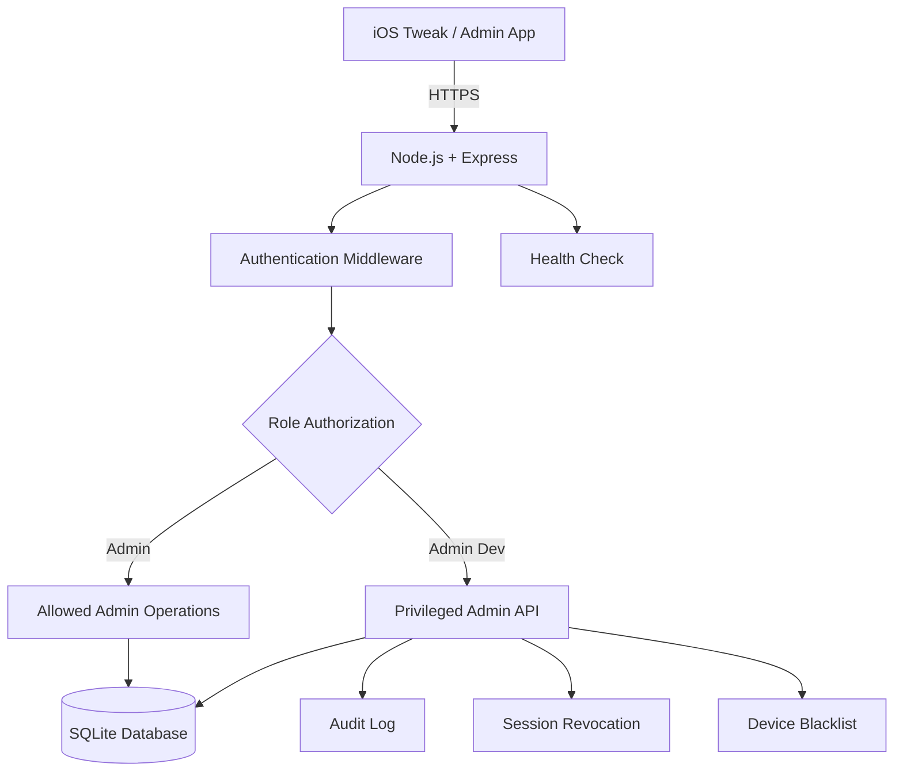

# 🛡️ iOS Tweak Admin Backend

<p align="center">
  <strong>Secure • Lightweight • Role-Based • SQLite-Powered</strong>
  <br>
  Backend quản lý quyền Admin/Admin Dev, phiên đăng nhập, blacklist thiết bị và nhật ký kiểm toán dành cho hệ sinh thái iOS tweak.
</p>

<p align="center">
  
  
  
  
  
</p>

---

## ✨ Overview

**iOS Tweak Admin Backend** là backend Node.js/Express sử dụng SQLite để quản lý xác thực và quyền truy cập cho ứng dụng quản trị tweak iOS.

Các chức năng chính:

* 🔐 Xác thực Admin và Admin Dev.
* 👥 Phân quyền dựa trên vai trò tài khoản.
* 🎫 Xác thực yêu cầu bằng Bearer token.
* 📱 Theo dõi trạng thái check-in bằng mã thiết bị giả danh.
* 🚫 Quản lý blacklist thiết bị.
* 🔄 Thu hồi phiên đăng nhập.
* 🧾 Ghi nhật ký audit phục vụ kiểm tra hoạt động.
* ⏱️ Quản lý các khoảng thời gian vi phạm.
* 💾 Lưu dữ liệu bền vững bằng SQLite.
* 🩺 Endpoint health check dành cho giám sát dịch vụ.

> **Security first:** Các thao tác đặc quyền phải được xác thực và kiểm tra quyền tại backend. Ẩn nút trên giao diện ứng dụng không thay thế được việc kiểm tra quyền ở máy chủ.

## 🧩 Architecture



### Technology stack

| Component            | Technology                      |
| -------------------- | ------------------------------- |
| Runtime              | Node.js 20+                     |
| HTTP server          | Express.js                      |
| Database             | SQLite                          |
| Password storage     | bcrypt hash                     |
| API authentication   | Bearer token                    |
| Production transport | HTTPS                           |
| Deployment           | Node.js hosting + reverse proxy |

## 📁 Project Structure

Cấu trúc tham khảo; tên file thực tế phụ thuộc vào repository của bạn.

```text
.
├── src/
│   ├── routes/          # API routes
│   ├── middleware/      # Authentication and authorization
│   ├── services/        # Business logic
│   └── database/        # SQLite access
├── .env.example         # Environment variable template
├── .gitignore
├── package.json
├── package-lock.json
└── README.md
```

## 🚀 Getting Started

### Requirements

* Node.js 20 trở lên
* npm
* SQLite tương thích với dependency của dự án
* HTTPS endpoint khi triển khai công khai

### 1. Clone repository

```bash
git clone <YOUR_REPOSITORY_URL>
cd <YOUR_PROJECT_DIRECTORY>
```

Thay hai giá trị placeholder bằng URL và tên thư mục repository thực tế.

### 2. Install dependencies

```bash
npm install
```

### 3. Configure environment

```bash
cp .env.example .env
```

Mở `.env` và thay toàn bộ mật khẩu mẫu bằng thông tin bí mật riêng. Kiểm tra các biến môi trường mà ứng dụng thực sự hỗ trợ trước khi khởi động.

**Không commit `.env` hoặc mật khẩu thật lên GitHub.**

### 4. Start the server

```bash
npm start
```

### 5. Check service health

Khi server chạy trên máy cục bộ tại cổng `8080`:

```bash
curl http://127.0.0.1:8080/health
```

Endpoint này dùng để kiểm tra tình trạng dịch vụ, không nên được xem là bằng chứng rằng mọi API quản trị đều hoạt động chính xác.

### 6. Production deployment

Trước khi đưa backend lên Internet:

* Cấu hình HTTPS thông qua Caddy, nginx hoặc nền tảng hosting phù hợp.
* Giới hạn quyền truy cập vào database và file backup.
* Cấu hình firewall, giới hạn tốc độ yêu cầu và logging.
* Sử dụng mật khẩu mạnh, riêng biệt cho từng tài khoản.
* Không truyền thông tin đăng nhập qua kết nối HTTP công khai.

---

## 👤 Accounts & Roles

| Role      | Environment variables                   | Intended access                              |
| --------- | --------------------------------------- | -------------------------------------------- |
| Admin     | `ADMIN_USER` / `ADMIN_PASSWORD`         | Các thao tác được backend cho phép           |
| Admin Dev | `DEV_ADMIN_USER` / `DEV_ADMIN_PASSWORD` | API quản trị đặc quyền được backend cho phép |

Mật khẩu được lưu dưới dạng bcrypt hash. Theo cấu hình dự án, thông tin tài khoản đã tồn tại không bị ghi đè mỗi lần server khởi động.

### Credential management

* Không sử dụng mật khẩu ví dụ trong môi trường thật.
* Không đưa mật khẩu, token hoặc secret vào source code.
* Xây dựng quy trình đổi mật khẩu và thu hồi phiên riêng.
* Giới hạn quyền truy cập database cho tài khoản hệ thống cần thiết.
* Không coi tên tài khoản hoặc giao diện client là bằng chứng về quyền Admin Dev.

## 🌐 API Reference

Tất cả endpoint dưới đây được lấy từ cấu hình dự án đã mô tả. Các endpoint yêu cầu Bearer token cần gửi token trong header:

```http
Authorization: Bearer YOUR_ACCESS_TOKEN
```

### Authentication

| Method | Endpoint          | Purpose                              |
| ------ | ----------------- | ------------------------------------ |
| `POST` | `/v1/auth/login`  | Đăng nhập                            |
| `GET`  | `/v1/auth/me`     | Kiểm tra tài khoản và phiên hiện tại |
| `POST` | `/v1/auth/logout` | Đăng xuất                            |

**Login request example**

```json
{
  "username": "your_username",
  "password": "your_password",
  "device_id": "optional-pseudonymous-id"
}
```

Không sử dụng thông tin đăng nhập thật trong ví dụ, log công khai hoặc ảnh chụp màn hình.

### Device monitoring

| Method | Endpoint              | Purpose                              |
| ------ | --------------------- | ------------------------------------ |
| `POST` | `/v1/monitor/checkin` | Gửi trạng thái check-in của thiết bị |

Request example:

```json
{
  "device_id": "stable-random-id",
  "tweak_version": "1.0.0"
}
```

Endpoint check-in yêu cầu Bearer token theo mô tả hiện tại.

### Admin Dev operations

| Method   | Endpoint                        | Access    | Purpose                     |
| -------- | ------------------------------- | --------- | --------------------------- |
| `GET`    | `/v1/admin/devices`             | Admin Dev | Xem danh sách thiết bị      |
| `POST`   | `/v1/admin/blacklist`           | Admin Dev | Thêm thiết bị vào blacklist |
| `DELETE` | `/v1/admin/blacklist/:deviceId` | Admin Dev | Xóa thiết bị khỏi blacklist |
| `POST`   | `/v1/admin/revoke-session`      | Admin Dev | Thu hồi phiên đăng nhập     |
| `POST`   | `/v1/admin/violation`           | Admin Dev | Ghi nhận vi phạm tài khoản  |
| `GET`    | `/v1/admin/audit`               | Admin Dev | Xem audit log               |

**Blacklist request**

```json
{
  "device_id": "stable-random-id",
  "reason": "Policy violation"
}
```

**Revoke session request**

```json
{
  "session_id": "session-id-to-revoke"
}
```

**Violation request**

```json
{
  "username": "target_username",
  "device_id": "optional-pseudonymous-id"
}
```

Theo chính sách được mô tả, các lần vi phạm có thể dẫn đến khóa tài khoản theo thời hạn tăng dần. Hãy kiểm tra implementation thực tế trước khi dựa vào các mốc thời gian hoặc cơ chế khóa vĩnh viễn.

---

## 🔒 Security

### Password security

* Dùng bcrypt để lưu hash mật khẩu.
* Không lưu mật khẩu dạng văn bản thuần.
* Không ghi thông tin đăng nhập vào audit log.
* Bổ sung giới hạn số lần đăng nhập thất bại và quy trình đổi mật khẩu an toàn nếu chưa có.

### Session security

* Kiểm tra token và quyền truy cập ở phía server.
* Thu hồi phiên khi phát hiện phiên không còn hợp lệ.
* Các thao tác nhạy cảm cần từ chối truy cập khi không thể xác minh quyền.
* Không dựa hoàn toàn vào dữ liệu quyền được lưu ở client.

### Database & audit

* Bảo vệ file SQLite và bản backup bằng quyền truy cập phù hợp.
* Lưu audit log đủ để điều tra nhưng không chứa mật khẩu hoặc token bí mật.
* Kiểm tra khả năng phục hồi database và quy trình backup định kỳ.
* Kiểm soát quyền truy cập endpoint quản trị bằng middleware phía server.

### Privacy

API monitoring được thiết kế để lưu mã thiết bị giả danh do client gửi, phiên bản tweak và thời điểm check-in gần nhất.

Mã thiết bị giả danh vẫn có thể được liên kết với một thiết bị hoặc người dùng nếu có dữ liệu đối chiếu. Vì vậy, cần giới hạn mục đích sử dụng, quyền truy cập và thời gian lưu dữ liệu.

Backend không nên được mô tả là có quyền truy cập iCloud hoặc dữ liệu riêng tư của thiết bị nếu không có cơ chế được cấp quyền tương ứng.

### Important limitations

* Thu hồi quyền không thể được bảo đảm tức thời khi thiết bị mất kết nối mạng.
* Client có thể bị sửa đổi; mọi thao tác đặc quyền phải được backend xác minh.
* Hệ thống này không tự cung cấp khả năng vượt entitlement của iOS.
* Backend không thực hiện gỡ tweak từ xa hoặc làm ứng dụng bị crash theo mô tả hiện tại.
* Chỉ nên công bố các cơ chế bảo mật đã được kiểm thử thực tế.

---

## ⚙️ Configuration

Các biến dưới đây là những biến được đề cập trong tài liệu dự án. Kiểm tra `.env.example` để biết tên biến đầy đủ và giá trị mặc định thực tế.

| Variable             | Description                 |
| -------------------- | --------------------------- |
| `ADMIN_USER`         | Tên đăng nhập Admin         |
| `ADMIN_PASSWORD`     | Mật khẩu khởi tạo Admin     |
| `DEV_ADMIN_USER`     | Tên đăng nhập Admin Dev     |
| `DEV_ADMIN_PASSWORD` | Mật khẩu khởi tạo Admin Dev |
| `DB_PATH`            | Vị trí file database SQLite |

Không công khai giá trị thật của các biến trên. Nếu đổi mật khẩu của tài khoản đã tồn tại, hãy sử dụng quy trình reset hoặc migration phù hợp với implementation hiện tại; không giả định rằng đổi `.env` sẽ tự thay mật khẩu trong database.

## 🧪 Recommended Testing

Trước khi phát hành, hãy kiểm tra ít nhất:

* [ ] Đăng nhập đúng và sai mật khẩu.
* [ ] Token không hợp lệ hoặc hết hạn bị từ chối.
* [ ] Admin không thể gọi endpoint chỉ dành cho Admin Dev.
* [ ] Blacklist được áp dụng đúng và có thể gỡ theo quyền.
* [ ] Thu hồi phiên có hiệu lực ở các yêu cầu tiếp theo.
* [ ] Quy tắc xử lý vi phạm hoạt động đúng với từng trường hợp.
* [ ] Audit log không làm lộ mật khẩu hoặc token.
* [ ] Database vẫn tồn tại sau khi restart server.
* [ ] API nhạy cảm được bảo vệ qua HTTPS khi triển khai công khai.
* [ ] Hành vi khi server offline hoặc database gặp lỗi là an toàn.

## 🗺️ Roadmap

Các mục dưới đây là đề xuất phát triển, không phải cam kết rằng chúng đã được triển khai.

* [ ] Rate limiting cho đăng nhập và API nhạy cảm
* [ ] Quy trình reset mật khẩu an toàn
* [ ] Kiểm thử tự động cho authorization
* [ ] Health check mở rộng và monitoring
* [ ] Quy trình backup/restore database
* [ ] Chính sách lưu trữ và xóa dữ liệu monitoring
* [ ] CI kiểm tra lint, test và build trước khi release

## 🤝 Contributing

1. Fork repository.
2. Tạo branch riêng cho thay đổi.
3. Thêm test cho các thay đổi liên quan đến bảo mật.
4. Chạy test trước khi gửi pull request.
5. Không đưa secret, database production hoặc dữ liệu người dùng vào commit.

## 📄 License

Thêm giấy phép phù hợp với quyền phân phối của dự án, ví dụ MIT, Apache-2.0 hoặc giấy phép riêng. Không nên ghi một license khi chưa xác định quyền sử dụng và phân phối source code.

---

<p align="center">
  <strong>Built for maintainability. Designed with security in mind.</strong>
  <br>
  <sub>Documented behavior should always match the actual server implementation.</sub>
</p>
