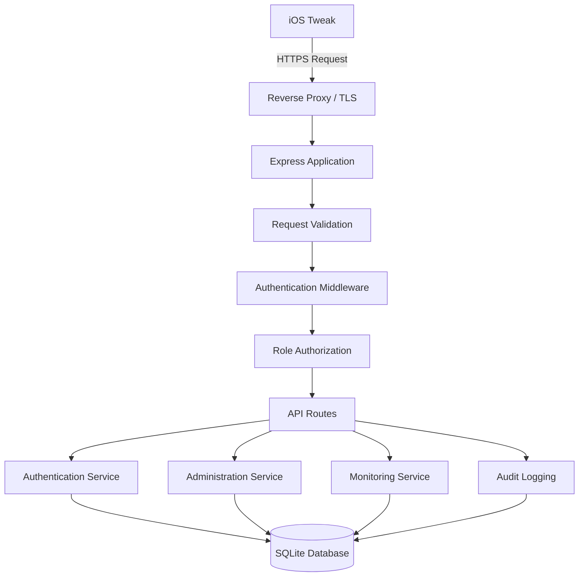
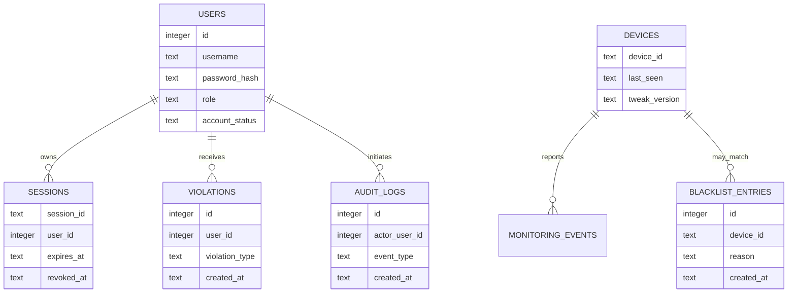

#  Apple-Compatible Service

<p align="center">
  <strong>Secure Backend Infrastructure for iOS Tweaks</strong>
</p>

<p align="center">
  Authentication · Access Control · Session Management · Device Monitoring
</p>

<p align="center">
  
  
  
  
</p>

---

## Table of Contents

* [Overview](#overview)
* [System Architecture](#system-architecture)
* [Project Structure](#project-structure)
* [Core Components](#core-components)
* [Authentication System](#authentication-system)
* [Authorization and Roles](#authorization-and-roles)
* [Session Management](#session-management)
* [Device Monitoring](#device-monitoring)
* [Blacklist Management](#blacklist-management)
* [Violation Management](#violation-management)
* [Audit Logging](#audit-logging)
* [API Reference](#api-reference)
* [Database Design](#database-design)
* [Environment Configuration](#environment-configuration)
* [Installation](#installation)
* [Production Deployment](#production-deployment)
* [Security Recommendations](#security-recommendations)
* [Troubleshooting](#troubleshooting)
* [Disclaimer](#disclaimer)

---

## Overview

Apple-Compatible Service Gateway is a backend service architecture designed for iOS tweak authentication, administrative access control, session handling, device monitoring, and server-side authorization.

The service provides a centralized backend for an iOS tweak to communicate with authentication and administration endpoints over HTTPS.

The interface name is configurable. This project is an independent service and is not an official Apple service or an Apple-operated server.

### Key Features

| Component          | Description                                   |
| ------------------ | --------------------------------------------- |
| Authentication     | Server-side account authentication            |
| Password Security  | Password hashing using bcrypt                 |
| Role Management    | Separation between Admin and Admin Dev        |
| Session Control    | Session validation and revocation             |
| Device Monitoring  | Device identifier and tweak-version check-ins |
| Blacklist          | Persistent server-side device restrictions    |
| Violation Tracking | Configurable account violation policies       |
| Audit Logging      | Records administrative operations             |
| Database           | Persistent SQLite storage                     |
| Transport Security | HTTPS deployment behind a reverse proxy       |
| Health Check       | Endpoint for basic service availability       |

### Design Principles

* **Server-side authorization:** privileged operations must be validated by the backend.
* **Persistent state:** security-related records must survive application restarts.
* **Least privilege:** each role receives only the permissions it needs.
* **Explicit failure handling:** authentication and authorization failures must not be treated as successful.
* **Minimal data collection:** collect only the device and account information needed for the service.
* **Maintainability:** separate HTTP routes, business logic, persistence, and configuration when the project structure supports it.

---

## System Architecture

The following diagram describes the intended request flow. Actual module boundaries depend on the backend implementation.



### Request Lifecycle

1. The iOS tweak sends an HTTPS request to the configured service endpoint.
2. The reverse proxy terminates TLS and forwards the request to the application.
3. The application validates the request method, body, and required parameters.
4. Authentication middleware validates the session or bearer token where required.
5. Authorization middleware checks the role required by the endpoint.
6. The route invokes the relevant service logic.
7. Database changes are persisted where applicable.
8. The application returns a structured HTTP response.

A successful login must not automatically grant administrative privileges. Each privileged endpoint must independently enforce its authorization rules.

---

## Project Structure

The following is a reference structure for organizing the backend. It is not a claim that every directory already exists in the current implementation.

```text
apple-compatible-service-gateway/
├── server.js
├── package.json
├── package-lock.json
├── .env
├── .env.example
├── .gitignore
├── README.md
│
├── src/
│   ├── app.js
│   │
│   ├── config/
│   │   ├── environment.js
│   │   └── database.js
│   │
│   ├── routes/
│   │   ├── auth.routes.js
│   │   ├── admin.routes.js
│   │   ├── monitoring.routes.js
│   │   └── health.routes.js
│   │
│   ├── middleware/
│   │   ├── authenticate.js
│   │   ├── authorize.js
│   │   ├── validateRequest.js
│   │   ├── rateLimit.js
│   │   └── errorHandler.js
│   │
│   ├── services/
│   │   ├── auth.service.js
│   │   ├── session.service.js
│   │   ├── admin.service.js
│   │   ├── monitoring.service.js
│   │   └── violation.service.js
│   │
│   ├── repositories/
│   │   ├── user.repository.js
│   │   ├── session.repository.js
│   │   ├── device.repository.js
│   │   └── audit.repository.js
│   │
│   └── utils/
│       ├── response.js
│       └── logger.js
│
├── data/
│   └── .gitkeep
│
├── logs/
│   └── .gitkeep
│
└── tests/
    ├── auth.test.js
    ├── admin.test.js
    └── monitoring.test.js
```

### Directory Responsibilities

| Path                | Responsibility                                                |
| ------------------- | ------------------------------------------------------------- |
| `server.js`         | Application entry point, if used by the project               |
| `src/app.js`        | Express application setup                                     |
| `src/config/`       | Environment and database configuration                        |
| `src/routes/`       | HTTP endpoint definitions                                     |
| `src/middleware/`   | Authentication, authorization, validation, and error handling |
| `src/services/`     | Business rules and workflows                                  |
| `src/repositories/` | Database access layer                                         |
| `src/utils/`        | Shared utility functions                                      |
| `data/`             | Persistent database files, if configured here                 |
| `logs/`             | Application logs, if file logging is enabled                  |
| `tests/`            | Automated test suites                                         |

If the current backend is a single-file Node.js application, these directories are an optional refactoring plan rather than files that can be assumed to exist.

---

## Core Components

### 1. HTTP Application

The HTTP layer receives requests and produces responses. It should handle:

* Route registration.
* JSON request parsing.
* Request-size limits.
* CORS policy, if cross-origin clients are needed.
* Request validation.
* Centralized error handling.
* Health-check responses.

Do not expose stack traces, database paths, environment variables, or secret configuration in production error responses.

### 2. Authentication Service

The authentication layer verifies submitted credentials against stored account records.

Expected responsibilities:

* Validate username and password input.
* Retrieve the relevant account.
* Compare the submitted password with its bcrypt hash.
* Reject disabled or restricted accounts.
* Create an authenticated session after successful verification.
* Return only the public account fields required by the client.

### 3. Authorization Service

Authentication determines who is making a request. Authorization determines whether that account may perform the requested action.

Every administrative endpoint must validate the account's role and session status on the server. Hiding a button in the iOS interface is not an authorization mechanism.

### 4. Persistence Layer

The database layer stores durable application state, including accounts, sessions, blacklist records, monitoring records, and audit events where supported by the schema.

Database access should use parameterized queries and appropriate transactions. Database files and backups must not be publicly accessible.

---

## Authentication System

### Login

**Endpoint:** `POST /v1/auth/login`

Example request:

```json
{
  "username": "example_user",
  "password": "replace_with_your_password",
  "device_id": "example-device-id"
}
```

The `device_id` field is optional in the documented API contract.

A successful response should contain only the information required by the client, such as a session token and minimal account metadata. The precise response fields must match the actual backend implementation.

### Current Session

**Endpoint:** `GET /v1/auth/me`

Required header:

```http
Authorization: Bearer YOUR_SESSION_TOKEN
```

This endpoint checks whether the current session is valid and whether the associated account remains permitted to access the service.

### Logout

**Endpoint:** `POST /v1/auth/logout`

The server should invalidate the active session where session revocation is supported. Removing a token only from local storage does not invalidate a copied token on the server.

### Password Storage

Passwords should never be stored in plaintext. Use bcrypt or another appropriate password-hashing algorithm with a suitable work factor.

Never commit production passwords, access tokens, private keys, or `.env` files to a public repository.

---

## Authorization and Roles

The documented account roles are:

| Role        | Intended permissions                                                                      |
| ----------- | ----------------------------------------------------------------------------------------- |
| `admin`     | Standard administrative access defined by the backend                                     |
| `admin_dev` | Development administration, including designated device and security-management endpoints |

The exact permissions must be enforced by server-side middleware and route handlers.

### Role Configuration

```dotenv
ADMIN_USER=change_this_admin_username
ADMIN_PASSWORD=replace_with_a_strong_password

DEV_ADMIN_USER=change_this_dev_username
DEV_ADMIN_PASSWORD=replace_with_another_strong_password
```

These are example environment variable names. Configure them only if the application actually reads them.

### Authorization Requirements

* Validate the session before executing privileged operations.
* Check role permissions on every restricted endpoint.
* Reject missing, malformed, expired, revoked, or invalid credentials.
* Avoid returning sensitive account information in API responses.
* Log security-relevant administrative actions.
* Do not rely on client-side flags to grant elevated access.

---

## Session Management

Session management allows the server to determine whether an authenticated client remains authorized.

### Expected Capabilities

* Session creation after successful authentication.
* Server-side validation of bearer tokens.
* Session invalidation on logout, where implemented.
* Administrative session revocation.
* Rejection of revoked sessions.
* Revalidation of authorization for sensitive operations.

### Revoke Session

**Endpoint:** `POST /v1/admin/revoke-session`

Permission: `admin_dev`.

Example request:

```json
{
  "session_id": "example-session-id"
}
```

The backend should verify the caller's role before revoking the target session and record the action in the audit log when audit logging is enabled.

Do not assume that revocation reaches an offline client immediately. A disconnected client cannot receive an immediate server response; access must be checked again when it reconnects.

---

## Device Monitoring

### Check-in

**Endpoint:** `POST /v1/monitor/checkin`

Required authentication: bearer token.

Example request:

```json
{
  "device_id": "example-device-id",
  "tweak_version": "1.0.0"
}
```

The monitoring endpoint can be used to record a device identifier, the reported tweak version, and the last-seen timestamp.

### Device Data

The documented monitoring design uses minimal operational metadata, such as:

* Pseudonymous device identifier.
* Reported tweak version.
* Last-seen timestamp.
* Relevant status information, if supported.

Avoid collecting unrelated personal data. Explain the collection and retention policy to users where appropriate.

A client-reported device identifier or version is not, by itself, proof that a device or binary is genuine.

---

## Blacklist Management

Blacklist records allow the backend to persist restrictions against designated device identifiers.

### List Devices

**Endpoint:** `GET /v1/admin/devices`

Permission: `admin_dev`.

### Add a Blacklist Entry

**Endpoint:** `POST /v1/admin/blacklist`

Permission: `admin_dev`.

Example request:

```json
{
  "device_id": "example-device-id",
  "reason": "Administrative review"
}
```

### Remove a Blacklist Entry

**Endpoint:** `DELETE /v1/admin/blacklist/:deviceId`

Permission: `admin_dev`.

### Operational Requirements

* Validate device identifiers before database operations.
* Record the reason and timestamp where the schema supports them.
* Restrict modifications to authorized administrators.
* Use parameterized database queries.
* Audit changes to the blacklist.
* Define a retention and review policy for blacklist entries.

---

## Violation Management

**Endpoint:** `POST /v1/admin/violation`

Permission: `admin_dev`.

Example request:

```json
{
  "username": "example_user",
  "device_id": "example-device-id"
}
```

The documented policy describes the following escalation schedule:

| Violation        | Intended restriction          |
| ---------------- | ----------------------------- |
| First violation  | 3-hour restriction            |
| Second violation | 3-day restriction             |
| Third violation  | Permanent account disablement |

This schedule is the documented policy, not a guarantee that every backend version implements it exactly. Verify the actual code before relying on these durations.

### Recommended Implementation Rules

* Store violation events durably.
* Use server-side timestamps.
* Define how violation counts are calculated and reset, if applicable.
* Make permanent disablement explicit and auditable.
* Prevent unauthorized clients from submitting administrative violations.
* Provide a controlled process for reviewing and correcting erroneous restrictions.

---

## Audit Logging

**Endpoint:** `GET /v1/admin/audit`

Permission: `admin_dev`.

Audit logs provide a record of important security and administration events.

Examples include:

* Successful or failed administrative actions.
* Blacklist additions and removals.
* Session revocation.
* Violation-policy actions.
* Relevant account-management changes.

Where supported by the database schema, audit records should include an event type, timestamp, acting account, target resource, and outcome.

Do not log plaintext passwords, bearer tokens, private keys, or complete authentication secrets. Restrict access to audit data and define a retention policy.

---

## API Reference

The following table summarizes the documented endpoint contract.

| Method   | Endpoint                        | Purpose                              |
| -------- | ------------------------------- | ------------------------------------ |
| `GET`    | `/health`                       | Basic service health check           |
| `POST`   | `/v1/auth/login`                | Authenticate an account              |
| `GET`    | `/v1/auth/me`                   | Validate the current session         |
| `POST`   | `/v1/auth/logout`               | End the current session              |
| `POST`   | `/v1/monitor/checkin`           | Submit a monitoring check-in         |
| `GET`    | `/v1/admin/devices`             | Retrieve device information          |
| `POST`   | `/v1/admin/blacklist`           | Add a blacklist entry                |
| `DELETE` | `/v1/admin/blacklist/:deviceId` | Remove a blacklist entry             |
| `POST`   | `/v1/admin/revoke-session`      | Revoke a session                     |
| `POST`   | `/v1/admin/violation`           | Register an administrative violation |
| `GET`    | `/v1/admin/audit`               | Retrieve audit events                |

### Access Requirements

| Endpoint group | Authentication            | Authorization                              |
| -------------- | ------------------------- | ------------------------------------------ |
| Health         | Usually not required      | Public health status only                  |
| Login          | Not required before login | Credential validation                      |
| Session        | Bearer token              | Valid session                              |
| Monitoring     | Bearer token              | Valid session and applicable account rules |
| Administration | Bearer token              | Required administrative role               |

The table describes the intended contract. Confirm the implementation for exact response formats, status codes, and role assignments.

---

## Database Design

The backend uses SQLite according to the documented project description.

The following is a conceptual data model, not a verified list of tables from the current database.



### Database Operations

* Keep the database in a private application data directory.
* Back up the database securely.
* Use transactions for related changes.
* Add indexes to frequently queried fields where appropriate.
* Use parameterized queries.
* Test migrations and restore procedures before production deployment.
* Avoid storing secrets that are not required for the service.

---

## Environment Configuration

Create a local environment file from the example configuration if the project provides one.

```bash
cp .env.example .env
```

Example configuration:

```dotenv
NODE_ENV=production
PORT=8080

ADMIN_USER=change_this_admin_username
ADMIN_PASSWORD=replace_with_a_strong_password

DEV_ADMIN_USER=change_this_dev_username
DEV_ADMIN_PASSWORD=replace_with_another_strong_password

DB_PATH=./data/service.sqlite
```

Only retain variables supported by the actual application. The server must explicitly load and validate each variable it requires.

### Configuration Checklist

* Replace all example credentials.
* Keep `.env` out of version control.
* Set restrictive permissions on secrets and database files.
* Use a stable, writable database path.
* Configure production logging without exposing secrets.
* Place the service behind HTTPS.
* Never assume that a variable is active simply because it appears in this example.

---

## Installation

### Requirements

* Node.js 20 or later.
* npm.
* SQLite support compatible with the project's dependencies.
* A server or development environment with permission to run the application.

### Install Dependencies

```bash
npm install
```

### Configure Environment

```bash
cp .env.example .env
```

Edit `.env` and replace every example credential before starting the service.

### Start the Application

```bash
npm start
```

The actual startup command depends on the scripts defined in `package.json`. If `npm start` is not configured, use the command documented by the project.

### Health Check

For local development:

```bash
curl http://127.0.0.1:8080/health
```

This example assumes the application listens on port `8080` and exposes the documented health route.

Do not expose the development HTTP endpoint directly to the public internet.

---

## Production Deployment

### Recommended Network Layout

```text
iOS Tweak
    |
    | HTTPS
    v
Public Reverse Proxy
    |
    | Private application connection
    v
Node.js / Express Service
    |
    v
Private SQLite Database
```

The public service name can be configured independently from the internal application layout. A reverse proxy can provide a stable public hostname without exposing the backend's private network address.

### Reverse Proxy Requirements

* Use a valid TLS certificate.
* Redirect public HTTP traffic to HTTPS.
* Forward requests only to the intended application service.
* Apply request-size and timeout limits.
* Restrict direct access to the backend port.
* Keep private service addresses out of public documentation and client-facing error messages.

### iOS Client Configuration

The tweak should use the actual HTTPS base URL configured for the deployment.

For example, in a local development configuration:

```text
https://api.example.com
```

Replace the example hostname with the domain you control. Do not publish a real private hostname in a public README unless you intentionally want it to be public.

Changing a display label in documentation does not change the URL embedded in the tweak, DNS records, reverse-proxy configuration, or network requests.

---

## Security Recommendations

### Authentication

* Hash passwords using bcrypt or an appropriate password-hashing algorithm.
* Apply login rate limits.
* Return generic authentication errors where appropriate.
* Never log submitted passwords.
* Rotate credentials if they are exposed.

### API Security

* Require HTTPS for production credentials and session tokens.
* Validate input types, lengths, and allowed values.
* Enforce authorization on the server for every privileged endpoint.
* Apply rate limits to sensitive routes.
* Use a centralized error handler.
* Avoid leaking internal stack traces or configuration.

### Session Security

* Use sufficiently unpredictable session tokens.
* Define session expiry.
* Invalidate revoked sessions server-side.
* Recheck authorization for sensitive actions.
* Avoid storing bearer tokens in logs or public files.

### Database Security

* Restrict database file permissions.
* Use prepared statements.
* Back up data to a protected location.
* Test restoration.
* Keep database backups outside the public web root.

### Operational Security

* Keep dependencies updated.
* Monitor application errors and service health.
* Protect SSH and server administration access.
* Store production secrets in an appropriate secret-management mechanism.
* Test security-sensitive workflows before deployment.

---

## Troubleshooting

### Application Does Not Start

Check the Node.js version, installed dependencies, startup script, required environment variables, and application logs.

```bash
node --version
npm --version
npm install
npm start
```

### Database Errors

Check that the configured database directory exists, the application has write permissions, and the SQLite dependency is installed correctly.

### Authentication Fails

Verify that the account exists, the password matches its stored hash, the account is enabled, and the server and client agree on the authentication request format.

### Administrative Request Returns Unauthorized

Check the bearer token, session validity, role assignment, and server-side authorization middleware. A client-side role label does not grant permission.

### Tweak Cannot Connect

Verify DNS, TLS certificate validity, the configured HTTPS base URL, reverse-proxy routing, server availability, and the API paths expected by the client.

Do not solve connection failures by disabling TLS verification in production.

---

## Disclaimer

Apple-Compatible Service Gateway is an independent backend project intended for authorized administration and service integration.

The name and visual presentation used in this README do not imply endorsement, ownership, operation, or certification by Apple Inc.

Use only systems and device identifiers you are authorized to administer. Protect account credentials, minimize data collection, and follow applicable privacy and security requirements.

---

<p align="center">
  <strong>Independent Service Gateway</strong>
  <br>
  Secure · Maintainable · Server-Side Access Control
</p>
